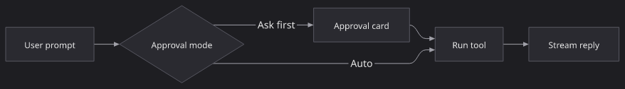
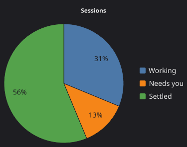

# Diagrams and agent-built UI

Researched on 2026-10-17 for TOB-33. The [scope](../scope.md) asks for interactive charts, diagrams, forms, and tools in chat, and says the rendering approach is unproven. This note proposes one, in three steps. TOB-34 covers step 1 and TOB-35 step 2.

## Pele renders Mermaid without a browser

[Pele](https://pele.run/) ([source](https://github.com/obsidianmd/pele), MIT, built for Obsidian) turns Mermaid source into an SVG string. Version 1.6.0 supports every diagram type built into Mermaid 12.1 except external plugins such as ZenUML. Its `render()` is synchronous and needs no DOM. Outside a browser it measures text with a built-in width table, or with a `measurer` the host supplies. `pele.global.js` is 682 KB, or 252 KB gzipped.

Its own layout engine places nodes differently from Mermaid.js, and it draws no HTML labels. It limits input to 50,000 characters, output to 4,000,000 characters, and flowcharts to 5,000 edges. It has no time limit; the host has to add one.

## The probe

A throwaway Rust program, kept outside the repo, evaluated `pele.global.js` in QuickJS through `rquickjs` 0.9. It rasterized the output with resvg 0.46, the version tGPUI uses for SVG images in `img()`. Release build on this machine:

| Step | Time |
| --- | --- |
| Evaluate the bundle once | 52–97 ms |
| Six-node flowchart, warm | 1.3–1.9 ms |
| Sequence diagram, warm | 0.2–0.3 ms |
| Pie chart, warm | 0.1 ms |
| Resolve variables and rasterize, including a system font load per call | 5–12 ms |

The probe binary was 4.8 MB, QuickJS included.

Pele's SVG output needed two fixes before resvg drew it correctly:

1. **Colors.** The root `style` maps private variables to public ones, as in `--_fg:var(--pele-fg,#1f1f1f)`. Elements then use `fill="var(--_fg)"`. usvg does not resolve CSS custom properties, so every shape filled black. The probe replaced each `--_x` with the theme's value for its `--pele-*` name, or with Pele's fallback. Any remaining `var(--pele-*, fallback)` was resolved the same way.
2. **Font.** usvg ignored the `font-family` in the root `style` attribute. Text fell back to a symbol font that maps Latin letters to Greek. Setting `font-family` as an attribute on the root `<svg>` fixed it.

| Unresolved | Resolved, dark theme |
| --- | --- |
|  |  |

The flowchart's "Ask first" label sits close to its arrow. The built-in width table and the actual font disagree. A `measurer` backed by GPUI's text system would remove the gap.

## Step 1: diagrams in replies

TOB-34.

- **Component.** `Block::Code` with language `mermaid` becomes a diagram component in `keystone-ui`, with a toggle back to the source. The copy button stays.
- **Streaming.** A block still being streamed shows its code. It renders once the incremental parser closes the block.
- **Runtime.** One background thread owns the QuickJS runtime, created on first use. An interrupt handler bounds each render.
- **Width.** `maxWidth` is the reply column width, so Pele can switch a wide flowchart to a vertical layout instead of shrinking it.
- **Theme.** A theme change re-runs only the substitution and rasterization, not the Pele render. Results are cached by source, width, and theme.
- **Options.** `images: false` stops agent-written diagrams from fetching URLs. Links stay off until step 3. Agent text never supplies `options` or `options.config`; frontmatter in the source can still change settings.

Rasterizing loses selectable text, zoom, and clickable links. Step 3 restores what matters.

## How ChatGPT does it

OpenAI shipped Intelligent UI with GPT-6 on 2026-10-07 ([TechCrunch](https://techcrunch.com/2026/10/07/chatgpt-is-getting-a-lot-more-visual-with-the-launch-of-a-new-interface/), [help article](https://help.openai.com/am-et/articles/20001598-intelligent-ui-in-chatgpt)). The model chooses per answer between text and visuals such as buttons, forms, calculators, sliders, and editable charts. Some components, such as checklists, keep state within a thread. Users can reduce the amount of visuals. OpenAI has not published the format.

Keystone does not control the model, so the agent has to ask for UI through a tool.

[PR #23](https://github.com/tobygodat/keystone/pull/23) is related but separate. There, a user describes a change to Keystone's own layout and a provider proposes it. Here, an agent puts widgets inside its reply.

## Both CLIs accept tools hosted by Keystone

Both providers let the parent process define tools over the connection Keystone already holds. No extra process or MCP configuration file is needed.

**Claude Code 2.1.301.** The `initialize` control request accepts `sdkMcpServers`, a list of server names, and optional `sdkMcpServerConfigs`. The CLI then sends `control_request` messages with subtype `mcp_message`, carrying `server_name` and one MCP JSON-RPC `message`. Keystone answers with the server's JSON-RPC reply under `mcp_response`. `mcp_set_servers` replaces the set mid-session. The CLI's own schema describes this; the official Agent SDKs use it for in-process tools. The CLI rejects it in cloud-hosted sessions, which do not apply to Keystone.

**Codex 0.163.0.** `thread/start` accepts `dynamicTools`, a list of `{type: "function", name, description, inputSchema}` specs or namespaces of them. Codex sends a server request `item/tool/call` with `threadId`, `turnId`, `callId`, `tool`, and `arguments`. Keystone answers with `{success, contentItems}`, where each item is `inputText`, `inputImage`, or `inputAudio`. `dynamicTools` appears only in `codex app-server generate-json-schema --experimental`, so Keystone gates it on the version and falls back to text if Codex rejects it.

A tool beats asking the model for a special fenced block in three ways. Keystone validates the call against a schema. It returns errors the agent can correct. It also returns the user's input as the tool result.

## A2UI as the widget format

[A2UI](https://a2ui.org/) is Google's Apache-2.0 protocol for agent-built UI. v0.9.1 is the current release, and v1.0 is a release candidate. An agent sends data, not code:

- `createSurface` names a `surfaceId` and a `catalogId`.
- `updateComponents` sends a flat list of components with ids, one of them `root`.
- `updateDataModel` sets a value at a JSON Pointer.
- `deleteSurface` removes a surface.

Props bind to the data model by JSON Pointer. The client sends an `action` with the button's `name`, `surfaceId`, `sourceComponentId`, `timestamp`, and bound `context`. Validation errors use code `VALIDATION_FAILED`. The basic catalog has these components:

- **Layout:** Row, Column, List, Card, Tabs, Modal, Divider.
- **Display:** Text, Image, Icon, Video, AudioPlayer.
- **Input:** TextField, CheckBox, ChoicePicker, Slider, DateTimeInput.
- **Action:** Button.

A catalog lists the components a client draws. GPUI fits that model: each entry maps to a `keystone-ui` component, and nothing outside the catalog renders. Keystone would publish its own catalog id. It starts as a subset of the basic catalog and adds `Diagram`, whose prop is Mermaid source drawn by the step 1 component.

A2UI's client-side functions are a fixed, named set: validation, formatting, logic, and `openUrl`. They are not arbitrary code. A calculator needs more, which is why computed values wait for step 3.

## Step 2: the show_ui tool

TOB-35, blocked on UC-03 (TOB-17) for Slider and ChoicePicker.

- **Tool.** One `show_ui` tool, whose input is a list of A2UI messages. Its description teaches the catalog, so no system prompt is needed.
- **First catalog.** Column, Row, Card, Text, Divider, Button, CheckBox, TextField, ChoicePicker, Slider.
- **State.** Input stays local to the surface's data model. A Button action returns the action and its context to the agent. During the turn it is the tool result; after it, a steer or a new message.
- **Inbox.** A surface waiting on the user appears in the attention inbox like an approval. Settlement never answers it.
- **Persistence.** Surface state is saved in the session's log, keyed by tool call id, so it survives a restart.
- **Tests.** `keystone-fake-claude` and `keystone-fake-codex` script the tool calls, so most checks need no live provider.

Neither model is trained to reach for visuals the way GPT-6 is. How often agents use the tool depends on its description. A setting to reduce visuals, like ChatGPT's, keeps that in the user's hands.

## Step 3: computed values and interactive diagrams

Not yet filed.

- **Computed values.** A Keystone catalog function, `compute`, takes an expression over the data model and runs it in the step 1 QuickJS runtime. The runtime has no host functions, no file or network access, and an interrupt deadline. This departs from A2UI's no-code rule on purpose, and only inside that sandbox. A slider can then drive a value or a chart; at 0.1–2 ms a render, a chart can follow the slider.
- **Diagram hit-testing.** Pele marks each node and edge with `data-id`. usvg gives each element's bounding box. Together they support:
  - highlighting a node on hover by re-coloring that id;
  - clicking a node to send "about this node" to the agent, which the scope's "sending selections to agents" covers;
  - zooming by rasterizing at a larger scale;
  - links from `RenderResult.links`, through an allowlist.

## Rejected

- **HTML in a webview** (MCP Apps, artifact-style pages). GPUI has no embedded webview, webview child windows are unreliable on Wayland, the output would not look native, and it gives agent-written content a browser. An "open in browser" action can cover full HTML pages later.
- **Node or Deno at run time.** It adds a system dependency for one feature.
- **Porting Pele to Rust.** It is a large layout engine that changes often. Revisit only if QuickJS proves too heavy.
