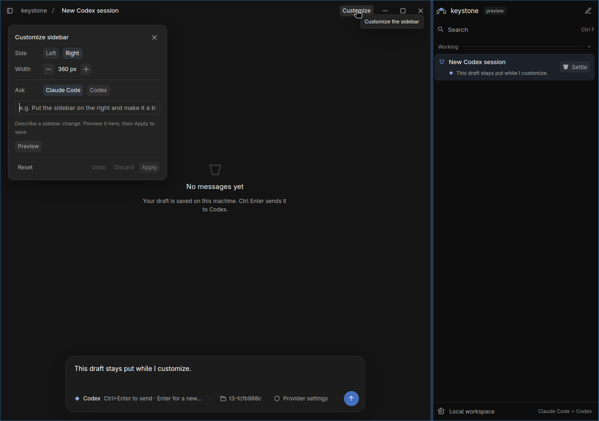

# Sidebar customization MVP

The native GPUI app can preview and save a sidebar on either side of the window, with a preferred width of 220–520 px. Open **Customize** in the top bar to use direct controls or ask Claude Code or Codex for a proposal.

## Verified behavior

- Native mouse input moved the sidebar and resized it from both inner edges. Apply saved the layout. Undo restored the previous saved layout. Reset remained a preview until Apply.
- Actual Claude Code and Codex requests produced validated previews. The workspace file did not change until Apply. The conversation draft stayed intact and unsent.
- An unavailable Codex executable showed an error, retained the prompt, and offered Retry. Manual controls still worked. A successful manual Apply cleared the stale error.
- At 640 × 360, Apply and Undo remained visible. The sidebar rendered narrower while its saved preferred width remained unchanged.
- Ctrl+Q exited with code 0. Restart restored the sidebar and the draft. The customization controls remained usable after restart.
- The session-rename dialog opened over Customize. Escape closed the dialog while leaving Customize open.

Core checks, the complete UI checks, and the additional rename-dialog interaction test passed. Provider boundary tests cover invalid proposals, stale results, cancellation, queued events past the deadline, and cumulative output limits. Save tests cover failure, pending directory synchronization, and older workspace files.

## Limits

This MVP changes sidebar side and width. It does not generate components, rewrite application code, or support freehand annotations. Undo holds one step for the current app run.

The panel body scrolls in short windows, while its save controls stay fixed. Native wheel scrolling could not be verified with the repository's driver, which already records that limitation as KS-012. Keyboard submission was used in the short-window run. Panel buttons do not yet have a Tab sequence; the documented shortcuts remain available.

The local `.audit/generative-ui-mvp.md` report records binary identity, action logs, workspace snapshots, screenshots, review findings, and cleanup. Every native verification run ended without cleanup errors or retained temporary state.
